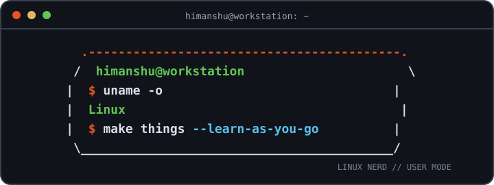

# `himanshu@workstation`

<p align="center">
  
</p>




```bash
himanshu@workstation:~$ whoami
himanshu

himanshu@workstation:~$ uname -o
GNU/Linux

himanshu@workstation:~$ cat ~/about.txt
CS student | SAP consultant
Into backend development, Linux systems, system design, and cloud.
I break things. Then I learn how they work.

himanshu@workstation:~$ ls ~/projects
E-SHELL
Inventory-Management
Task-Tracker
Portfolio

himanshu@workstation:~$ fastfetch --config profile
       .--.           himanshu@workstation
      |o_o |          --------------------
      |:_/ |          OS: GNU/Linux
     //   \ \         Role: CS student · SAP consultant
    (|     | )        Focus: backend · Linux · systems
   /'\_   _/`\        Projects: 4
   \___)=(___/        Status: always learning

himanshu@workstation:~$ cat ~/currently-learning
ABAP
Networking
Scripting
Algorithms
Autonomous Enterprise

himanshu@workstation:~$ _
```

`himanshu@workstation:~$ xdg-open` [LinkedIn](https://www.linkedin.com/in/himanshu-mishra-389085373)

`himanshu@workstation:~$ xdg-open` [Medium](https://medium.com/@mishrahimanshu7372)
